# Sofle OLED Wireless (ZMK)



## Architecture & Custom Module Overview

This repository is both a **ZMK user config** (`config/`) and a **self-contained Zephyr/ZMK module** (`zephyr/module.yml`, `CMakeLists.txt`, `Kconfig`, `src/`, `dts/`, `include/`). Because `zephyr/module.yml` exists at the repository root, ZMK's `build-user-config.yml` workflow automatically passes `-DZMK_EXTRA_MODULES="${GITHUB_WORKSPACE}"` to `west build`, so no ZMK fork or external module repository is needed in `config/west.yml`.

Currently pinned ZMK version: **`v0.3`** (`config/west.yml`).

---

## Custom Features

### 1. Persistent Per-Endpoint Default Layer (`WIN` / `MAC`)
- **Files**:
  - `src/behaviors/behavior_default_layer.c` (compiled on central only)
  - `dts/behaviors/default_layer.dtsi`
  - `dts/bindings/behaviors/zmk,behavior-default-layer.yaml`
  - `include/dt-bindings/zmk_behavior_default_layer/default_layer.h`
- **Config (`config/sofle_left.conf`)**:
  ```ini
  CONFIG_ZMK_DEFAULT_LAYER=y
  CONFIG_ZMK_DEFAULT_LAYER_MIN_INDEX=0
  CONFIG_ZMK_DEFAULT_LAYER_MAX_INDEX=1
  ```
- **How it works**:
  - Stores a `uint8_t endpoint_defaults[ZMK_ENDPOINT_COUNT]` array under Zephyr NVS settings key `"default_layer/settings"`.
  - `&df DF_SEL WIN` (`0`) and `&df DF_SEL MAC` (`1`) update the default layer for the selected output endpoint (USB, or BLE profile `0..4`; each has its own slot), activate/deactivate layers in `[MIN_INDEX, MAX_INDEX]`, and save to flash after `100` ms (`DEFAULT_LAYER_SAVE_DELAY_MS`, rather than ZMK's 60-second `CONFIG_ZMK_SETTINGS_SAVE_DEBOUNCE`).
  - Why this is vendored instead of using `cormoran/zmk-feature-default-layer`:
    1. `cormoran/zmk-feature-default-layer@main` targets ZMK `v0.4` APIs (`zmk_endpoint_get_selected()`, 2-arg `zmk_keymap_layer_activate(id, locked)`).
    2. `cormoran/zmk-feature-default-layer@zmk-v0.3.0.0` has a boot/profile-switch bug on ZMK `v0.3`: `SYS_INIT` runs before `main()` calls `settings_load()`, so `ble/active_profile` is not loaded yet at `default_layer_init()` time, and subscribing only to `zmk_ble_active_profile_changed` can read `zmk_endpoints_selected()` before `endpoints.c` updates `current_instance`.
    3. `cormoran` waits `CONFIG_ZMK_SETTINGS_SAVE_DEBOUNCE` (60s) before writing to flash. Our implementation writes to NVS flash after `100` ms. Both key by `zmk_endpoints_selected()`, so wired output (USB HID to a host) has its own default layer, separate from the BLE profiles; a charge-only USB connection does not change the selected endpoint.

### 2. Best-Effort Central -> Peripheral Sleep Heartbeat (`actping`)
- **Files**:
  - `src/split_sleep_heartbeat.c`
  - `dts/behaviors/actping.dtsi`
  - `dts/bindings/behaviors/zmk,behavior-actping.yaml`
- **Config**:
  - `config/sofle_left.conf`:
    ```ini
    CONFIG_ZMK_IDLE_TIMEOUT=60000
    CONFIG_ZMK_SLEEP=y
    CONFIG_ZMK_IDLE_SLEEP_TIMEOUT=600000
    CONFIG_ZMK_SPLIT_SLEEP_HEARTBEAT=y
    CONFIG_ZMK_SPLIT_SLEEP_HEARTBEAT_INTERVAL_MS=10000
    ```
  - `config/sofle_right.conf`:
    ```ini
    CONFIG_ZMK_IDLE_TIMEOUT=60000
    CONFIG_ZMK_SLEEP=y
    CONFIG_ZMK_IDLE_SLEEP_TIMEOUT=60000
    CONFIG_ZMK_SPLIT_SLEEP_HEARTBEAT=y
    ```
- **How it works**:
  - Defines a 0-argument global behavior `actping` (`BEHAVIOR_LOCALITY_GLOBAL`).
    - **Important**: The devicetree node name (`actping`) must be `<= 8` characters (`ZMK_SPLIT_RUN_BEHAVIOR_DEV_LEN` is `9` in `zmk/app/include/zmk/split/bluetooth/service.h`) and **must not** use `/omit-if-no-ref/` because it is invoked from C timer/work code rather than referenced in a keymap matrix.
  - **Central (`sofle_left`)**:
    - Runs a `k_work_delayable` every `10000` ms while `zmk_activity_get_state() != ZMK_ACTIVITY_SLEEP` (`ACTIVE` or `IDLE`) and invokes `actping`, which ZMK's split transport forwards to connected peripherals via GATT write-without-response.
    - When central enters `ZMK_ACTIVITY_SLEEP` (after 10 min of inactivity) or powers off, the delayed work stops.
  - **Peripheral (`sofle_right`)**:
    - Stops ZMK's stock `activity_timer` (which is non-`static` in `zmk/app/src/activity.c`) at `SYS_INIT` priority `95` (after `activity_init` at `CONFIG_APPLICATION_INIT_PRIORITY = 90`).
    - Tracks `last_local_activity` (from `zmk_position_state_changed` / `zmk_sensor_event`) and `last_split_heartbeat` (from `actping` binding press).
    - Uses `last_local_activity` against `CONFIG_ZMK_IDLE_TIMEOUT` (`60000` ms) to transition `ZMK_ACTIVITY_IDLE` (so the right OLED still blanks after 1 min of no right-hand typing even while receiving heartbeats). Note: `activity.c`'s listener still transitions `ZMK_ACTIVITY_ACTIVE` on local right-side key/sensor events.
    - Uses `MAX(last_local_activity, last_split_heartbeat)` against `CONFIG_ZMK_IDLE_SLEEP_TIMEOUT` (`60000` ms) to enter `ZMK_ACTIVITY_SLEEP` (`zmk_pm_suspend_devices()` + `sys_poweroff()`).

### 3. Power & OLED Optimizations
- `CONFIG_ZMK_RGB_UNDERGLOW=n`, `CONFIG_WS2812_STRIP=n`: Disables the 20 Hz (`50 ms`) RGB underglow timer/DMA loop since no physical underglow LEDs are installed. Note: `CONFIG_ZMK_EXT_POWER=y` **must remain enabled** on `nice!nano v2` because `EXT_POWER` (`P0.13`) controls the 3.3V `VCC` rail that powers the I2C OLED display.
- `CONFIG_ZMK_DISPLAY_TICK_PERIOD_MS=100`: Lowers LVGL display refresh tick from 100 Hz (`10 ms`) to 10 Hz (`100 ms`).
- `CONFIG_ZMK_DISPLAY_BLANK_ON_IDLE=y` & `CONFIG_ZMK_IDLE_TIMEOUT=60000`: Blanks OLED (`SSD1306` hardware sleep) after 60s of inactivity.
- Separate `config/sofle_left.conf` and `config/sofle_right.conf`: Note that in ZMK `v0.3`, `modules.cmake` appends **all** matching `.conf` files (`sofle.conf` + `sofle_left.conf`/`sofle_right.conf`), so `config/sofle.conf` was removed to avoid ambiguity.

---

## ZMK `v0.4` Upgrade Checklist (Zephyr 4.1)

When upgrading `config/west.yml` from `revision: v0.3` to `v0.4` / `main`:

1. **Board name & workflow (`build.yaml` & `.github/workflows/build.yml`)**:
   - In `.github/workflows/build.yml`, change `@v0.3.0` to `@main` (or `@v0.4.0`).
   - In ZMK `v0.4` (Zephyr 4.1 hardware model v2), `nice_nano_v2` is replaced by `nice_nano/nrf52840/zmk` (or `nice_nano@2.0.0` depending on ZMK board alias). Check ZMK's Zephyr 4.1 migration blog post.
2. **`src/behaviors/behavior_default_layer.c` API changes in ZMK `v0.4`**:
   - `zmk_endpoints_selected()` was renamed to `zmk_endpoint_get_selected()` (`<zmk/endpoints.h>`).
   - `zmk_keymap_layer_activate(id)` and `zmk_keymap_layer_deactivate(id)` gained a second `bool locking` parameter in `v0.4`:
     ```c
     zmk_keymap_layer_deactivate(zmk_keymap_layer_index_to_id(i), true);
     zmk_keymap_layer_activate(zmk_keymap_layer_index_to_id(layer_index), true);
     ```
   - Alternatively, you can compare against `cormoran/zmk-feature-default-layer@zmk-v0.4.0.0` (keep our `.h_commit` handler if boot-time endpoint ordering still applies).
3. **`src/split_sleep_heartbeat.c` check in ZMK `v0.4`**:
   - Verify `zmk/app/src/activity.c` still defines non-`static` `activity_timer`, `set_state(enum zmk_activity_state)`, and `is_usb_power_present(void)`. (Verified identical on ZMK `main` as of Zephyr 4.1).

---

## Local Build Command (Docker)

To test builds locally without pushing to GitHub Actions:

```bash
docker run --rm \
  -v "$PWD:/workspace/Sofle-oled_wireless:ro" \
  -v zmk-west-cache:/west-workspace \
  zmkfirmware/zmk-build-arm:stable \
  sh -exc '
    mkdir -p /west-workspace/config
    rm -rf /west-workspace/config/*
    cp -R /workspace/Sofle-oled_wireless/config/* /west-workspace/config/
    cd /west-workspace
    [ -d .west ] || west init -l /west-workspace/config
    west update --fetch-opt=--filter=tree:0
    west zephyr-export

    west build -p -s zmk/app -d /tmp/build-left -b nice_nano_v2 -S "studio-rpc-usb-uart" -- \
      -DZMK_CONFIG=/west-workspace/config \
      -DSHIELD="sofle_left" \
      -DZMK_EXTRA_MODULES="/workspace/Sofle-oled_wireless" \
      -DCONFIG_ZMK_STUDIO=y

    west build -p -s zmk/app -d /tmp/build-right -b nice_nano_v2 -- \
      -DZMK_CONFIG=/west-workspace/config \
      -DSHIELD="sofle_right" \
      -DZMK_EXTRA_MODULES="/workspace/Sofle-oled_wireless"

    west build -p -s zmk/app -d /tmp/build-reset -b nice_nano_v2 -- \
      -DZMK_CONFIG=/west-workspace/config \
      -DSHIELD="settings_reset" \
      -DZMK_EXTRA_MODULES="/workspace/Sofle-oled_wireless"
  '
```
